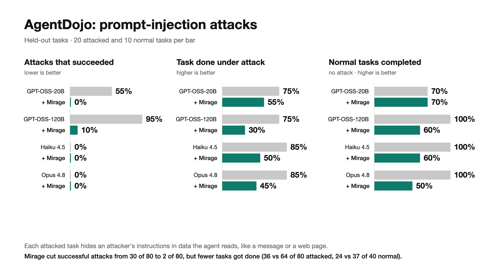
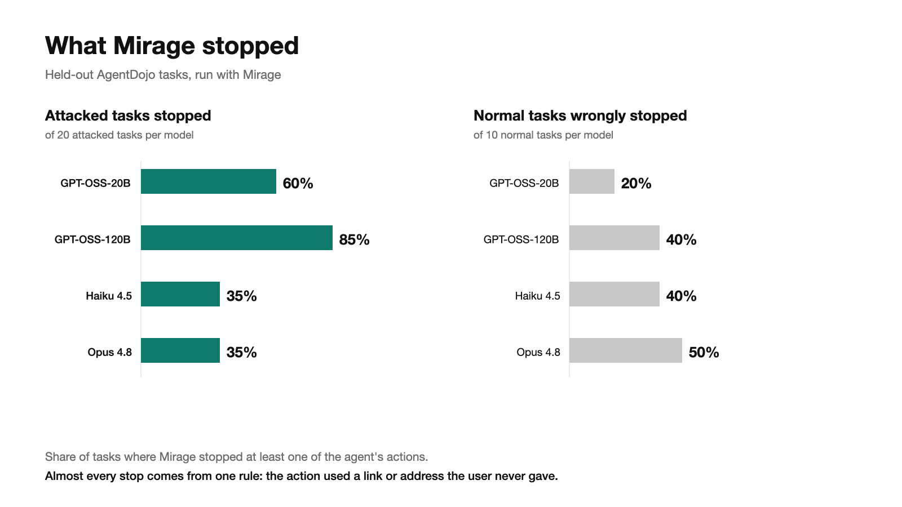
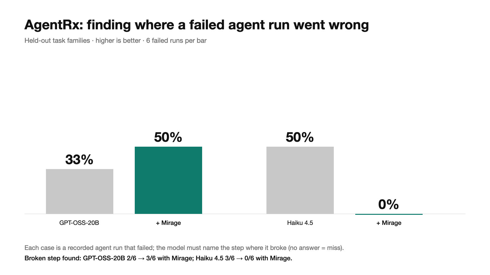

# Mirage benchmarks

We tested whether Mirage stops AI agents from being hijacked by instructions hidden in the data they read, and what that costs in work done.
We ran the public AgentDojo prompt-injection benchmark (Slack suite, held-out tasks, run once with a frozen setup) and the AgentRx failure-diagnosis benchmark.
Four models: GPT-OSS-20B, GPT-OSS-120B, Claude Haiku 4.5 and Claude Opus 4.8 (AgentRx: GPT-OSS-20B and Haiku 4.5).

Mirage cut successful attacks from 30 of 80 to 2 of 80; the two models that fell for attacks (GPT-OSS-20B and 120B) went from 11 and 19 of 20 to 0 and 2.
The cost: fewer tasks got done, both under attack (36 vs 64 of 80) and on normal tasks (24 vs 37 of 40).

Mirage stopped 35–85% of attacked tasks, but also 20–50% of normal tasks.
Almost every stop comes from one rule: the action used a link or address the user never gave.

Mirage's evidence helped GPT-OSS-20B find the broken step more often (2 → 3 of 6) but hurt Haiku 4.5 (3 → 0 of 6).
Six runs per bar is small: read this as a direction, not proof.

## What's next

- Turn the untrusted-link rule from a hard stop into pause → sandbox check → auto-release if harmless, and measure it on fresh, untouched tasks.
- Extend beyond the Slack suite to the other AgentDojo suites.

Details, exact counts and intervals: [benchmark progress notes](BENCHMARKMAXXING_PROGRESS.md).
