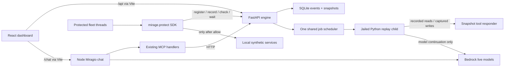
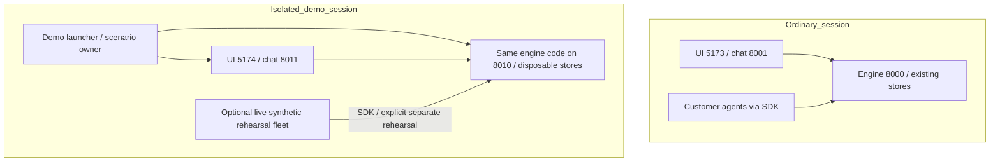

# Mirage UI and engine connection plan

Status: original source audit/planning, 2026-10-10, plus M1 startup and 2026-10-11 repair-status updates in section 0. Source audit: `84d1c0969ed04927ebad5bd32d8b5c09a08205d8`; current repair inspection: `d9c5f7744b1d742da03c9910427566ad9c5d0247`. Historical links/runtime observations and sections 1+ remain pinned; future proposals are not acceptance claims.

## 0. Milestone 1 startup implementation and scope

**M1 is recorded background plus fully real Miragio.** Production agents and engine detection, containment, detonation, proof and fix/PR lifecycle are recorded/simulated. Miragio uses real Bedrock, existing MCP handlers and human approvals against the recorded engine. **M2 later means actual agents, live gate/containment, snapshot sandbox execution and fresh deterministic proof.** M1 chat is already real. Offline providers, runtime metadata and controller migration remain outside M1.

Approved reuse option A is implemented by the Node standard-library `web/scripts/dev.mjs`, reusing Python Replay, installed Vite and built real chat. From `web/`, use `npm run dev -- --mode demo` or `npm run dev:demo`. `MIRAGE_UI_MODE=demo npm run dev` is equivalent; CLI mode wins. Plain `npm run dev` still starts only Vite and attaches to existing engine/chat ports 8000/8001. No newly implemented live engine profile exists.

Managed demo owns loopback web5174/engine8010/chat8011, a fresh absolute disposable state directory, absolute `fleet_demo_4agents.jsonl`, and non-instant 2× replay speed (configurable finite >0 through 10). Engine gets `MIRAGE_MODE=replay`, `MIRAGE_REPLAY_MANAGED=1` and isolated `MIRAGE_DB`/`MIRAGE_SNAPSHOTS`/`MIRAGE_TOKENS`. Chat and Vite share `MIRAGE_API`; Vite's `MIRAGE_CHAT_API` targets owned real chat. Actual localhost/127.0.0.1 web origins enter chat's allowlist. Children get `MIRAGE_UI_MODE=demo`; Vite exposes the nonsecret `import.meta.env.VITE_MIRAGE_UI_MODE='demo'` flag without query-string or localStorage selection.

Only chat receives credentials, through root `.env` or absolute `MIRAGE_CHAT_ENV_FILE`. Engine Replay and Vite do not inherit provider credentials. Launcher never reads/logs credential values, copies `.env`, starts a victim fleet, sends startup control POSTs, or starts engine provider/job work. Building real chat is a prerequisite (`cd mcp && npm run build`); no new dependencies or fake provider are introduced. Missing credentials fail startup; invalid credentials remain real provider errors. GET readiness proves availability, not Bedrock access.

Demo overrides `--port`, `--engine-port`, `--chat-port` beat `MIRAGE_DEMO_*_PORT` defaults, require distinct non-attach ports and always fail if occupied. Conflicting proxy/mode/fixture/origin/state settings fail rather than attach or kill another session. Startup failure/Ctrl+C terminates only owned child process groups and deletes only its temporary state. Full prerequisites/options are in [START.md](../START.md).

`npm run demo:selfcheck` uses stub children/temporary paths to check flag/environment precedence, strict ports, routing/origins/isolation, read-only readiness, failure/timeout and owned shutdown; existing web typecheck/build also apply. Managed lifecycle, evidence reset and chat/UI presentation are companion worker changes requiring composed acceptance. Recorded handoff is not a live snapshot capability; fixture fix/PR evidence cannot establish coding-agent verification, a real fix PR or human merge. Launcher selfchecks claim no provider-live or real-service acceptance.

**Current provenance (2026-10-11):** [M1 combined acceptance](DEMO_MILESTONE_1_ACCEPTANCE.md) records its exact tested compositions and real Miragio calls against recorded engine evidence. It does not accept the source fleet or fresh M2 proof. The current protected fleet is meeting assistant/invoicing/outreach/PR reviewer; the managed fixture substitutes support, reports 40 contacts, broadens the meeting task and uses a different poisoned invite. Current source tools are in-memory synthetic services seeded with eight contacts and two clean events plus one injected event. Standalone `python -m agents.<name>` modules are unprotected; use `agents.run_demo_fleet` or explicit UI demo start on an owned isolated live engine. [START.md](../START.md#protected-source-fleet-fresh-m2-synthetic-rehearsal) supplies that separate startup path without adding a managed live profile.

[Demo evidence](DEMO_EVIDENCE.md) separates current source, recorded M1, historical metrics and the two 2026-10-11 offline audits. [Repair acceptance ledger](UI_ENGINE_REPAIR_ACCEPTANCE_20261011.md) pins the merged repair PRs and their attributed RED/GREEN evidence through `d9c5f77`: invoice eligibility, gate-visible composite payloads, containment persistence, proof retry/crash accounting, bounded positive counts, immutable API/gateway/CLI config, destination/decision-response checks, completion declarations, shared execution-truth contract, service/human-control UI, handoff access wording and shared process-local model pacing. These are merged repairs with worker offline/synthetic evidence, not fresh composed M2 acceptance.

U1's shared execution contract is merged, but SDK/fleet callbacks and jailed error replay are pending; U3 stream recovery, U4 persistent proof and shared runtime/job metadata also remain pending. U2 services/human controls is merged and still needs browser acceptance. Full legitimate-task declarations and new exact-call approval/recovery authority repairs still need composed evidence. U5 documentation awaits the coordinator's final source SHA and owned engine8040/UI5180/chat8041 rehearsal evidence; staged UI/chat PIDs alone establish no engine/provider/browser acceptance, and existing user8000/5173/8001 are not test targets. The ledger keeps external coding-agent handoff/current-snapshot verification, failed-fix rejection, useful clean-fix completion and human PR/restart decisions open. Google/HubSpot integration and public cloud-fixer/deployment access remain separate gates; Mirage hands repairs to an external coding agent.

Coordinator browser evidence preserves earlier chat access denial and honest disconnected Fleet/502 while engine8040 was absent. After the user regenerated the key, Person A's fresh no-tool access probe returned HTTP200 for all six configured distinct Bedrock IDs, followed by bounded valid gate/judge usability on `d9c5f774`. Owned chat8041 rebuilt/restarted from that source (PID68595), and one actual native-browser5180/chat8041/Bedrock no-tool turn rendered the requested response, with AX and screenshot reported. This clears the reported access gate and accepts that limited browser-chat connection; engine8040 was still absent, so fleet/containment/sandbox/fix and engine-action acceptance remain open. Earlier failures are preserved without an inferred expiry/invalid-ID cause. Provider-free browser/HTTP checks, repairs and the reserved engine-invariant ledger continue separately; real services/deployment remain unaccepted.

## 1. Outcome and boundaries

Connect the existing dashboard to a visible, trustworthy incident lifecycle: live containment → automatic three-run sandbox replay → deterministic proof → human-directed cause search and coding-agent handoff → verified fix → human merge and clean restart. This serves the main calendar-injection demo, especially 0:30–2:40 in [PRODUCT.md, demo script][product-demo]. Initial replay must not need a dashboard click; production must remain frozen until a human decides. The existing engine already implements automatic scheduling ([gate freeze path][gate], [job authority][jobs]); the plan closes visibility, startup and demo-parity gaps around it.

Keep the [Person A/B split][ownership]: Person A owns engine API, replay server, gate, snapshots, scheduler, verdict, bisection and verification; Person B owns dashboard, SDK, demo agents, MCP/chat, fixtures, presentation and startup experience. Shared shapes stay in `contracts/models.py`; any eventual contract change updates models, fixtures and `CONTRACTS.md` in one commit, with both owners aligned ([contract rules][contract-rules]). `web/`, `mcp/` and `agents/` communicate with the engine over HTTP; never import engine modules into them ([architecture rule][architecture-rule]).

**Evidence labels:** “Current source” means the pinned revision above. “Runtime observation” means the coordinator's read-only report, not a new rehearsal by this document's author. “Proposal” means unimplemented behavior requiring the relevant owner's review. Source links below are pinned to the audit revision, so later merges cannot silently change the evidence.

Post-audit delivery update: remote main advanced to `3a7faed` before this plan shipped. PR #99 (`10021bd`) adds dashboard/MCP lift STOP and halted-run resume, including reason-dialog/API wiring ([delivered actions][resume-delivered]); preserve that work and validate it rather than rebuilding those controls. PR #100 sharpens gate policy/evaluation ([policy update][policy-delivered]). The detailed matrix and runtime snapshot remain explicitly pinned to `84d1c09`; these later merges were inspected as focused deltas, not a new full runtime audit.

## 2. What is working today

### 2.1 Coordinator runtime observation

The coordinator verified the following on 2026-10-10 against main, with source comparison pinned to the audit revision above. These observations are session evidence, not source-code claims:

| Surface | Reported observation | What it establishes |
|---|---|---|
| Engine | Port 8000, PID 79983, main checkout; main was `74ac79d` during audit and later advanced to `84d1c09` | Existing process is attached to the main checkout; current disk HEAD does not prove loaded code |
| UI | Vite on 5173, PID 80520, main `web/` | Dashboard is served by the current dev proxy |
| Chat | Port 8001, PID 51814, main `mcp/`; live Bedrock chat | Chat is a separate provider-backed process |
| API parity | `/runs`, `/incidents`, `/events` through `5173/api` exactly matched direct `8000` responses | The dashboard proxy is connected to that engine |
| State | Four runs: meeting assistant frozen with `inc_001`, others completed; incident `root_caused`, `next_action=send_fix`; 331 events, also 331 SQLite rows | Containment, baseline detonation, verdict and bisection evidence exist in this session |
| Event provenance | Events differ from both checked-in fixtures; baseline includes a preceding `human.action`; no automatic system queue marker | This is not fixture playback; recorded baseline replay was human-triggered |
| UI inspection | Existing incident handoff drawer rendered proof in read-only computer inspection | Current UI can display incident evidence and handoff; not proof of a fresh end-to-end demo |

The reported engine started at local **22:38:04**, before automatic detonation PR #77 / commit `90b238c` landed at **22:43:54**. Together with the missing system queue marker and the manual detonation audit, this is **strong evidence of stale loaded engine code as the initial automatic-replay cause**, not evidence that the new scheduler is missing. Do not restart or reset the user's current services to validate this plan. A future authorized rehearsal must start a known revision and observe a fresh gate incident; existing incidents are not automatically replayed on restore ([restore][engine-boot], [automatic contract][automatic-contract]).

**Independent confirmed configuration bug:** coordinator inspected only allowlisted non-secret settings and found root `.env` has `MIRAGE_MODE=replay`. API `MODE`/`REPLAY` are fixed at import ([boot][engine-boot]); the gate later reads `os.getenv("MIRAGE_MODE")` during freeze ([gate][gate]). Decision-model initialization and sandbox execution lazily load dotenv ([layer 2][decision-config], [sandbox environment][sandbox-env]). The coordinator reproduced the split in a fresh process, without writing events or calling models: unset shell `MIRAGE_MODE`, import `engine.api.server`, then load root dotenv. Exact reported output:

```text
API mode after import: live fixture replay enabled: False
API mode after later dotenv load: live gate scheduling environment mode: replay
mode mismatch: True
```

Restart alone may not solve this: in the **next authorized fresh session**, after safely settling old work, explicitly set shell `MIRAGE_MODE=live` for the live API; existing dotenv defaults do not override set shell values. [START.md][start] documents import-time mode selection. Proposal P0: load config once before imports, validate mode, freeze that resolved configuration and pass it to API/gate/scheduler; late credential loading must not change operational mode. Test absent shell + dotenv replay, explicit shell live + dotenv replay, invalid mode, and later environment mutation. This reproduction proves the current config bug, not that the already-running stale PID loaded the new scheduler.

### 2.2 “Live,” “synthetic” and “offline” mean different things

Current source: the fleet builds four genuine model-driven agents, calls `invoke` on separate threads, and seeds synthetic local state ([fleet runner][fleet]). Agent models use `ChatBedrockConverse`, temperature 0, and model IDs from environment ([agent model][agent-model]). Calendar reads an in-memory list, email appends to an in-memory outbox, and CRM reads/updates local records ([calendar tool][calendar-tool], [mail tool][mail-tool], [CRM tool][crm-tool], [service state][service-state]).

Therefore the current experience is **real engine + live models + local synthetic tools**, alongside **live operator chat**. It is not fully offline, and it is not equivalent to proving Gmail/Calendar/HubSpot integration. The product's real team-owned service target remains [PRODUCT.md's production environment][product-env]. Fleet size is currently four ([fleet runner][fleet]); the product script still describes three ([demo script][product-demo]). Use the current four-agent fleet in acceptance criteria and flag script alignment for Person B.

`Run.env=prod|mirage` describes the production or sandbox lane, not whether the model is live or the engine plays fixtures ([contract literals][models]). Do not add “demo” to that enum to solve startup mode selection.

### 2.3 Process and data flow



Current source: UI calls relative `/api`; Vite rewrites that prefix to `MIRAGE_API` (default 8000), and forwards `/chat` to `MIRAGE_CHAT_API` (default 8001) ([client][client], [Vite proxy][vite]). The SDK captures its engine URL at module initialization, gates each production tool, holds a frozen call via long polling, and routes sandbox tools to the engine callback without HTTP ([SDK core][sdk-core]). The engine folds events for REST reads and emits the same events through SSE ([read API][read-api], [state fold][state]). Chat reuses the existing MCP handlers and watcher ([chat service][chat-followup], [MCP HTTP client][mcp-client]).

### 2.4 Core architecture decision: separate demo ownership from engine ownership

Today these are intertwined: generic engine API hardcodes `DEMO_RUNNER=agents.run_demo_fleet`, `/demo/start` resets global state then spawns that child, `/demo/reset` deletes runs, registrations, SQLite, snapshots and handoff tokens, and API shutdown stops the fleet ([demo control][demo-api], [lifespan][engine-boot]). The gateway imports `engine.dev.tools` for its in-process development path ([dev coupling][gate-import]). A separate port alone does not isolate stores or reservations.

**Proposal:** demo is a client of the same reusable engine through SDK/HTTP. Each environment gets its own engine instance, ports, event database, snapshot directory, token store and process-local jobs. Scenario seeding and victim-fleet orchestration belong to Person B's demo launcher/controller. Ordinary engine accepts registrations and owns containment/snapshots/replay/proof; it should not import scenario modules or own destructive scenario lifecycle by default. No duplicated engine or browser fake backend. `demo/` is a proposed future controller location; it does not exist in the audited checkout ([desired layout][architecture-rule]).



| Boundary | Person A | Person B | First-stage rule |
|---|---|---|---|
| Engine security and recovery | Gate, job authority, snapshots, verdict, existing STOP/lift/resume/restart | Human control UX and SDK callers | Preserve new PR #98 `/resume` behavior; ordinary recovery remains available |
| Demo lifecycle | Explicit demo capability guards around destructive reset/start | Startup selection, dedicated stores/ports, fixtures/scenario process ownership | Proposed `MIRAGE_DEMO_CONTROLS=1` only on an explicitly designated instance; preserve manual runbooks via opt-in |
| Future decoupling | Remove scenario spawning from generic API; make dev dispatch optional | Move seeding/spawning to future demo controller | Incremental migration; no reversal of entrypoint-based human `/resume` |

Prioritize config, capability guards and state/process isolation now; migrate scenario spawning later. Recorded `demo` never launches Bedrock victim agents. A separately named **synthetic live rehearsal** may use the same isolated topology with `MIRAGE_MODE=live` and an explicitly selected fleet, but is not a fourth default UI mode or a hidden demo fallback.

## 3. Current endpoint and consumer matrix

All paths here are engine-root paths, reached by the browser with `/api` prepended. The browser is an HTTP consumer, not an engine orchestrator. These rows describe current implementations, not new endpoints.

| Endpoint | Current role / consumer | Live behavior | Fixture replay behavior | Source |
|---|---|---|---|---|
| GET `/runs`, `/runs/{id}`, `/incidents`, `/incidents/{id}` | Dashboard / MCP authoritative state | Fold SQLite event log; detailed incident query | Fold visible fixture events | [read routes][read-api], [fold][state] |
| GET `/events?after=seq`, `/stream?after=seq` | Browser event cache / MCP watcher | Ordered events; SSE IDs are seq; `Last-Event-ID` overrides query cursor | Same transport, visible fixture events | [SSE][read-api], [stream consumer][stream] |
| GET `/services/{outbox|calendar|crm}?env=prod|mirage` | Available for service proof panels | Event-derived views, not direct service health checks | Event-derived recorded views | [service route][read-api], [service contract][service-contract] |
| GET `/policies`, `/approvals` | Policy / medium-risk queue reads | Registrations/policy, pending calls | Visible fixture-derived approvals | [approvals/policies][approvals-api] |
| POST `/stop`, `/stop/lift` | Dashboard human action | STOP blocks calls; lift does not resume halted runs | Advance next segment | [STOP routes][control-api] |
| POST `/runs/{id}/freeze`, `/unfreeze`, `/kill` | Per-run human control; dashboard currently exposes unfreeze/kill | Status and ownership guards; unfreeze rejected during replay or after confirmation | Advance next segment | [controls][control-api], [UI actions][actions] |
| POST `/approvals/{call_id}/approve|reject` | Explicit medium-risk decision | Approve resumes held call, reject ends run | Advance next segment | [approvals][approvals-api] |
| POST `/runs/{id}/restart` | Human clean restart | New queued run; owner must start agent to take it over | Advance next segment | [restart][control-api] |
| POST `/runs/{id}/resume` | Human recovery of halted run | Requires STOP lifted and no confirmed compromise; launches registered entrypoint, else queues for owner | Advance next segment | [resume][control-api] |
| POST `/incidents/{id}/detonate?runs=3` | Explicit retry/operator replay; initial replay is automatic | Shared job reservation; return `{detonation_id}`, progress via events | Advance next segment, return its head payload | [incident routes][incident-api] |
| POST `/incidents/{id}/bisect?runs=2` | Dashboard / MCP cause search | Confirmed verdict required; background job | Advance next segment | [incident routes][incident-api] |
| POST `/incidents/{id}/handoff` | Human coding-agent handoff | Confirmed verdict required; prompt/report/incident token; does not launch fixer | Advance next segment | [incident routes][incident-api], [handoff][handoff] |
| POST `/incidents/{id}/verify?runs=3` | Fix test through HTTP | Background rerun of current code; incident token required when public | Advance next segment | [verify][incident-api] |
| POST `/incidents/{id}/pr` | Report a fix PR URL | Emits `pr.opened`; does not create or merge a PR | Current route still calls handoff event writer, unlike replay step routes; parity gap | [PR route][incident-api] |
| POST `/demo/start`, `/demo/reset` | Dashboard demo lifecycle | Start resets then launches fleet; reset clears data and tokens; 409 before mutation if active sandbox job | Restart recording | [demo routes][demo-api] |
| POST `/agents`, `/runs`, `/runs/{id}/model-calls`, `/gateway/check`, `/runs/{id}/tool-results`, `/runs/{id}/complete`; GET `/runs/{id}/wait` | SDK data plane, not UI | Registration, recording, gate, wait; run-token auth after start | 409, data plane disabled | [SDK routes][data-api] |
| GET `/openapi.json` | Type generation | FastAPI schema; web script targets localhost:8000 | Same contract | [boot][engine-boot], [web scripts][web-package] |

Human actions carry `{actor, reason}`; long incident actions accept it optionally and log `unknown` if omitted ([audit][incident-api]). Browser `ACTOR='liam'` is a demo audit label ([actions][actions]), not remote authentication. Chat endpoints live on the separate Node process: POST `/chat/turn`, POST `/chat/approvals/{id}`, GET `/chat/handoffs/{id}`, GET `/chat/sessions/{id}/events`, with their own SSE and approval rules ([chat contract][chat-contract]). Engine replay does not make chat offline.

## 4. Why detonation can be invisible

| Finding | Current evidence | Implication / proposed response |
|---|---|---|
| Running engine predates automatic scheduling | Coordinator runtime snapshot in §2.1 | Highest-confidence initial runtime cause; use a known revision in an isolated rehearsal, not a new scheduler |
| API/gate mode split after dotenv | Coordinator fresh-process reproduction in §2.1; [import-time mode][engine-boot], [dynamic gate mode][gate], [late dotenv][decision-config] | Confirmed independent bug; resolve one validated startup config before any service imports |
| Replay intentionally stops at baseline detonation | `step_of` marks every baseline `detonation.started` as an operator step; only `advance()` unlocks next segment ([Replay][replay]) | Fixture demo cannot demonstrate automatic live parity today; add opt-in automatic baseline playback |
| Queue window looks idle | Queue marker is a frozen→frozen system event; incident stays `open` until `detonation.started`; `NEXT_ACTION[open]=detonate` ([jobs][jobs], [fold][state]) | Incident page can show “Proof awaits detonation” and Detonate before queued job starts; use typed queue metadata and disable duplicate request while reserved |
| Queue detection depends on prose | Fleet compares the entire reason string ([fleet status][fleet-status]) | Prefer a typed queue state; prose remains display copy |
| No streaming health state | Polling starts only on `EventSource.CLOSED`; polling errors disappear; REST queries have no interval and disable focus refetch ([stream][stream], [client][client]) | Reconnecting SSE can leave state stale without a visible diagnosis; show reconnecting/polling/disconnected and bounded recovery |
| Reset outside this tab preserves its cursor | `seq > lastSeq` filtering; only local `resetStream()` clears cursor/cache ([stream][stream]) | Another tab, API reset or engine data replacement can reuse lower seqs that this tab ignores; introduce stream epoch |
| Partial reset cleanup | `disconnect()` clears source/poll but not pending invalidation timer; reset retains `clockOffset` ([stream][stream]) | Old callbacks/clock and in-flight REST responses can leak into new state; fence and cancel on generation change |
| Chat misses automatic baseline completion | Chat banner only checks current `detonating`/`bisecting`; service watches long jobs only after its own tool returns a cursor ([chat UI][chat-ui], [chat watcher][chat-followup]) | A gate-originated replay can finish before opening Chat; add persistent evidence card shared with Fleet/Incident, independent of model turns |
| Evidence events arrive late | Sandbox waits for all futures before emitting effects ([sandbox aggregation][sandbox]) | Current “running” can show zero effects for a while; do not invent per-run progress from elapsed time |
| Read history does not restore live locks | API restores agent registrations and STOP, but controls require a run in process-local `gate.runs` ([boot][engine-boot], [control guards][control-api]) | Recovered history can show frozen runs with no controllable live process; expose/control capability, explain 409, never fake a resume |

Current UI already renders deterministic verdict, blast radius, input bisection, failure notices, verification and PR links ([incident UI][incident-ui]). It has an event-based Fleet sandbox label ([fleet status][fleet-status]). Reuse those views; no replacement dashboard or second event store is needed. Coordinator source inventory found no web calls to `/services/*` or `/approvals`: service panels and a medium-risk approval banner are separate demo UX gaps, not proof of a broken API connection. Add small panels/banner only when required for the script; retain existing per-run actions. Static hosting also needs an explicit `/api`/`/chat` reverse proxy later, since the current proxy is Vite dev-server configuration ([Vite][vite]); that is outside this dev-startup plan.

## 5. Startup mode taxonomy (proposal)

This retains the broader original proposal for future work. Section 0 and [START.md](../START.md) are the implemented M1 guidance: recorded demo and existing attach only. Offline and newly managed live profiles remain deferred.

Use one **UI startup profile**, separate from engine lane and model provider:

| Proposed profile | Engine / agents | Chat | Truthful label | Default behavior |
|---|---|---|---|---|
| `live` | Existing real engine on 8000; current fleet uses live models and synthetic local tools | Existing live chat on 8001 | “Live engine · live models · synthetic services” when that deployment declares it | Plain `npm run dev` attaches; no reset/start of agents |
| `demo` | Own engine Replay on 8010 and web on 5174; recorded fleet, no agent/model detonation work | Own live chat on 8011, existing MCP client pointed to 8010 | “Recorded engine demo · live chat” | Recommended repeatable UI demo matching current conversational experience; credentials still required for chat |
| `offline` | Own Replay on 8010 and web on 5174; no model calls | Explicit scripted local provider on 8011 | “Offline demo · scripted chat” | Optional fallback; no Bedrock credentials/client, no hidden fallback from failed live chat |

“Demo” does not mean fully offline. “Live engine” does not mean real service integration. Runtime metadata must describe the actual connection rather than trusting a browser build label. Profiles are proposals: current `MIRAGE_MODE` is engine `live|replay`, read once on server import, with default `live`; audited direct Vite invocation with `--mode demo` only selected Vite mode and did not change engine or chat behavior ([engine configuration][engine-boot], [Vite configuration][vite], [official Vite modes][vite-modes]). Invalid engine modes currently fall into the non-replay path; eventual engine validation should fail startup for unknown values.

### 5.1 Proposed launch and precedence

Current M1 developer commands, from `web/` (the broader offline/live proposal remains deferred):

```bash
npm run dev -- --mode demo
MIRAGE_UI_MODE=demo npm run dev
npm run dev                          # attach existing live engine/chat
```

**M1 launcher semantics now exist as described in section 0.** The agreed implementation is a small Node stdlib dev launcher owned by Person B; reuse installed Vite, Node `child_process`, and the existing Python Replay server. The launcher resolves the profile, starts only owned children if required, waits on read-only readiness, and starts Vite with the resolved proxy targets. Person A owns any new engine flags. No process manager dependency, new mock API, Docker or browser-generated fake fleet state.

Implemented M1 precedence: CLI `--mode live|demo` overrides `MIRAGE_UI_MODE`, which overrides default `live` (attach only). Offline remains a deferred proposal. Leave `NODE_ENV` independent. Parse launcher profile flags; attach forwards remaining Vite flags, while managed demo permits only its documented port options and `--open`. Reject unsupported profile values. Explicit `MIRAGE_API` / `MIRAGE_CHAT_API` override defaults in live attach mode. For managed demo/offline, choose 8010/8011 (or explicit dedicated port options) and fail on occupied ports; do not silently attach to a service found there or reuse an override pointing at live 8000/8001. Reject conflicting inherited `MIRAGE_MODE=live` in managed demo rather than secretly starting real agents.

The launcher sets child `MIRAGE_MODE=replay`, absolute `MIRAGE_FIXTURE`, replay speed, isolated `MIRAGE_DB`, `MIRAGE_SNAPSHOTS` and `MIRAGE_TOKENS`, opt-in automatic baseline playback, and chat's `MIRAGE_API` to the **same replay engine URL** used by Vite. Existing path variables are supported ([event DB][event-store], [snapshots][snapshot-path], [tokens][token-path]); do not assume port isolation also isolates files. Browser chat proxy target uses `MIRAGE_CHAT_API`; chat's own engine target uses `MIRAGE_API` ([MCP defaults][mcp-client]). Set `MIRAGE_CHAT_ORIGINS` for the actual selected loopback web origin (default 5174) and chat origin (8011), including localhost/127.0.0.1 variants used. Default origins only cover 5173/8001 ([chat contract][chat-contract]). Use strict Vite port binding: explicit `--port` may override 5174 but must not silently fall back or reuse 5173. Resolve config before module imports; SDK `MIRAGE_URL` is distinct ([SDK config][sdk-core]).

Vite config currently reads only `process.env`, so merely adding `.env.demo` proxy targets will not work: Vite does not populate process.env from env files during config evaluation. Use explicit `loadEnv` with a narrow server-side prefix or resolved launcher environment, keep shell/CLI precedence, and never expose credentials ([official config env guidance][vite-config-env]).

Credential values stay server-side. No `VITE_*` key, browser credential setup or logging credentials. Live chat loads root `.env` before provider construction; launcher-selected routing must retain precedence over file defaults ([chat startup][chat-startup], [provider/env loader][chat-provider]). Offline must not instantiate that Bedrock provider. A live-provider failure stays a provider failure and suggests selecting offline explicitly; it never fabricates proof or silently switches modes.

### 5.2 Child lifecycle and readiness

Proposal: plain live attach starts only Vite. Managed demo owns engine/chat PIDs it created, never kills by port or process name, and never resets another checkout's services. Check uv/Node/dependency availability and fixture readability before spawning. If one child fails readiness or bind, stop only children from that launch and exit with a concise error. Ctrl+C forwards termination to owned processes, waits for graceful cleanup, then closes owned leftovers after a bounded timeout. Track launch identity and startup failures; do not interpret “port is listening” as identity proof.

Do not POST `/demo/start` at launcher boot: Replay already starts its initial segment ([Replay initialization][replay]). Starting a live fleet is a distinct human action. Demo reset remains explicit and should retain the selected scenario/profile, while changing the stream epoch. Tests must prove engine/MCP/proxy target agreement and zero writes to the existing 8000 engine.

## 6. Smallest reuse-based options

Goal: automatic incident proof visible in the existing dashboard and a reliable startup-selected recorded demo. These estimates are planning ranges, not commitments.

| Option | Reuse / external check | Estimated effort / risk | Decision |
|---|---|---|---|
| A: Retain native SSE, REST, Query cache and Replay; add metadata, generation fencing and a small launcher | Existing [stream][stream], [Replay][replay], [Vite][vite]; installed [sse-starlette][python-package] | 3–6 hours across A/B; fixture semantics and child ownership need focused tests | Recommended core approach |
| B: Run an isolated live model fleet every time demo starts | Existing [fleet][fleet] and scheduler | 1–2 hours setup, but injection/model/auth variability, rate pacing and resets remain | Separate live rehearsal, not reliable default demo |
| C: Build browser-only mock endpoints and fake chat | Would duplicate the engine fold, API guards and fixtures | Several hours plus drift; cannot establish gateway authority | Reject; reuse Replay and explicit provider seam |

Open-source check on 2026-10-10: reviewed the [sse-starlette README and Quick Start][sse-readme] (`EventSourceResponse` async generator) and its [minimal real example][sse-example]; reviewed [Vite modes][vite-modes] and [proxy configuration/example][vite-proxy]; reviewed TanStack's [QueryClient API][query-client] and [query invalidation example][query-invalidation]. These fit the installed stack and avoid introducing a transport or mock framework. [sse-starlette license][sse-license] is BSD-3-Clause, [Vite license][vite-license] is MIT, and [TanStack Query license][query-license] is MIT. This plan proposes reuse, no upgrades or new dependency selection. Native EventSource has distinct CONNECTING/OPEN/CLOSED states ([MDN][eventsource-state]); CLOSED-only fallback is insufficient as a visible connection policy.

The align-first proposal is **A**, with the additive contract changes below; Person A/B must review those changes before implementation. This docs-only task does not authorize implementing them.

## 7. Additive contract proposal

Do not rename existing routes, statuses, actions or `Env`. Keep `next_action` engine-authored. Add the following only after owner agreement, in a shared contract PR that updates models, fixtures, docs and generated types together ([contract rules][contract-rules]). Existing Pydantic models forbid unknown fields ([model configuration][models]); adding response fields is not automatically compatible with older strict clients. Update typed consumers together, or keep new metadata on a separate opt-in endpoint until clients support it.

### 7.1 Runtime metadata

Proposal: read-only GET `/runtime` returning a typed `RuntimeInfo`:

```text
engine_mode: live | replay
instance_id: opaque startup UUID
stream_epoch: opaque log-generation UUID
last_seq: integer
started_at: UTC timestamp
revision: string | null
tool_backend: synthetic | external | unknown
auto_detonation: boolean
replay_auto_baseline: boolean
```

`instance_id` changes on process restart; `stream_epoch` changes only when the event history is replaced/reset (and when Replay restarts). Preserve epoch across a live restart that retains the same log, or conservatively reload history if epoch persistence cannot be delivered in the demo slice. Revision must describe the loaded build at startup, not current disk HEAD. Declare capabilities from the running process/config; do not infer them from a mode string or a successful `/runs` read. `tool_backend=unknown` is truthful for mixed/unverified registrations; this is engine demo metadata, not a universal guarantee about every customer's tools.

Do not put chat provider or secrets in engine metadata: chat lives in another process. Proposal: a minimal read-only chat health response declares `provider=bedrock|scripted`, engine URL/identity match and readiness, without credentials. Launcher checks both identities. If omitted from the first slice, label chat provider from the known managed launch and do not claim attached chat verification.

### 7.2 Queue and job identity

Proposal: optional `Incident.sandbox_job` (default null), a typed object:

```text
id: string
purpose: detonate | bisect | verify
status: queued | running | completed | failed
n_runs: integer
error: sanitized string | null
```

Add optional typed queue metadata to the existing automatic frozen→frozen `run.status` payload, including job ID, `purpose=detonate`, `n_runs=3`, `status=queued`; preserve its reason text for old clients. Existing `detonation.started/completed/failed` and `fix.verified` drive later job states. `sandbox_job` represents the latest relevant job; retain historical baseline detonation by ID in the existing event ledger so verification cannot overwrite baseline proof. Queue/bisection must use a correlatable ID; do not reuse a display label as identity. Avoid a new EventType or IncidentStatus unless owners establish that existing events cannot carry the state.

Current scheduler reservations are process-local ([jobs][jobs]); the proposal reports that truth and does not promise crash-resumable jobs. On restore, an uncompleted reservation from a dead process must not appear actively running forever; mark unavailable/interrupted in metadata and offer explicit retry, while preserving production containment. An additive flag in runtime/control capabilities can indicate whether a run has a current live owner; do not claim full restoration of SDK tokens or locks.

### 7.3 Epoch-aware transport

Proposal: include stream epoch on a separate named SSE metadata message at connection, outside the existing `Event` stream; GET `/runtime` also exposes it for polling clients. Old `onmessage` clients continue receiving normal events. New clients establish epoch before accepting business events, and reopen without old `Last-Event-ID` if it differs. Keep ordinary IDs numeric within an epoch. Define and test server handling of a stale cursor/header before shipping; a mere metadata endpoint without reconciliation does not solve reset races.

Optional GET `/events` response header with epoch allows polling to bind rows to a generation without changing `Event[]`. Resolve restart/reset ordering atomically relative to reads, so a response never pairs old rows with a new epoch. Alternative for the smallest first slice: probe `/runtime` before and after catch-up and discard mismatched batches; document that handshake until an epoch header is implemented.

## 8. Reconnect, reset and stale-state handling (proposal)

1. Bootstrap with runtime identity, then fetch runs/incidents and events from 0 for that epoch. Display evidence only from the same epoch. Native SSE then catches up from the highest accepted seq; deduplicate ordered events by `(epoch, seq)`.
2. Expose a shared connection state: connecting, streaming, reconnecting, polling, disconnected. After a short bounded SSE reconnect window, start REST catch-up polling even while EventSource remains CONNECTING. Stop extra polling when streaming recovers; deduplicate overlap. Failures show a compact status and last successful sync time. Idle agents alone do not mean disconnection: use transport open/heartbeat or read-only health.
3. On transient failure with unchanged epoch, retain the cursor and evidence and catch up. Retry GETs only, with bounded/backoff timing. Never automatically replay POST controls or chat turns after an ambiguous response.
4. On changed epoch/backend, close transport, cancel timers and outstanding queries using abort signals, clear evidence and target-scoped caches, reset cursor and event clock, then bootstrap. Every response/callback carries a captured generation and is discarded if obsolete; cancel alone is insufficient if the fetch ignores its signal. Clear stale incident selections, pending actions, dialogs and handoff URLs, and route to Fleet if the old incident is absent. Theme/preferences can remain.
5. Local `/demo/start` or `/demo/reset` clears state **only after success**; 409 preserves evidence and explains active sandbox work. Other tabs and MCP/API-triggered resets are discovered via epoch checks. Include a periodic read-only runtime probe even when no new event arrives, since `after=oldHighSeq` can otherwise hide the new stream forever.
6. Separate destructive **Reset demo** from nondestructive **Reconnect/Refresh**. Explain current reset deletes event history, snapshots, tokens and active fleet. Refresh must not start agents, advance fixtures or lift STOP ([current reset][demo-api]).

Current `resetStream()` is reusable for local success handling but needs full generation cleanup; it currently invalidates caches without removing all old derived/detail data ([stream reset][stream]). TanStack already provides cancellation/invalidation/removal operations ([QueryClient][query-client]). Adopt them in the existing client rather than inventing a store.

## 9. Demo lifecycle parity and human decisions

### 9.1 Baseline replay in the proposed demo profile

Person A adds an opt-in Replay setting, proposed `MIRAGE_REPLAY_AUTO_BASELINE=1`, consumed only in `MIRAGE_MODE=replay`. Preserve default legacy manual fixture stepping for existing tests/clients. In opt-in mode the initial time-driven segment includes production activity, incident opening, automatic queue, baseline detonation, effects, completion and verdict. It stops before the first real human step (cause search, unfreeze/kill, STOP, handoff, verification or restart). No live sandbox subprocess or Bedrock agent calls run in Replay.

Revised fixtures must distinguish automatic baseline work from a human-triggered retry. Merge only the initial automatic baseline segment; do not automatically play bisection's removed-input detonations or verify-purpose runs. The sample currently represents manual detonation boundaries ([Replay semantics][replay], [fixture contract][fixtures]); Person B should record/update a fixture with three runs, typed queue marker and authentic timing. Preserve order and never fabricate a successful verification from a failure.

Replay currently advances the next segment for almost any control action, rather than validating the requested step/target ([Replay][replay], [control routes][control-api]). Proposal: validate expected operator step and legal target before advancing in managed demo, reject mismatch with 409, and leave recording unchanged. Do not let a chat kill request advance a bisection segment. Make `/pr` respect Replay rather than writing the live event store, or disable it explicitly in demo capabilities. Support/false-positive are accepted model values but live `/demo/start` only implements calendar and returns 501 for others ([DemoStart][demo-model], [demo routes][demo-api]); show only implemented scenarios until dedicated fixtures/agent acceptance exist.

### 9.2 Same proof story on Fleet, Incident and Chat

| Phase | Proposed audience-facing behavior | Authority / action |
|---|---|---|
| Working | Healthy/completed production runs remain visible | Retain backend statuses; “Healthy” is existing presentation, not a new running run ([fleet status][fleet-status]) |
| Frozen, queue reserved | “Contained. Three sandbox replays queued.” | No verdict yet; disable duplicate Detonate and unsafe unfreeze while reservation exists |
| Running | “Replaying the frozen context in Mirage.” Count captured effects only as received | `detonation.started` means execution, not reservation; don't animate invented per-run progress |
| Completed | Persistent 3-run result, blast radius and snapshot association | `verdict.ready`, deterministic `confirmed`; service panels distinguish blocked production from simulated effects |
| Failed | Persistent “No new proof established,” contained run, explicit Retry | `detonation.failed`; never count a crash as a clean false positive ([crash rule][sandbox]) |
| Confirmed | Find the cause, then human handoff | Engine `next_action`; bisection still human-triggered |
| False positive | Review captured effects; human may unfreeze held call | Existing engine guard; explain the held action that will execute |
| Fix work | Human opens/copies prompt; coding agent tests same snapshot | No automatic coding-agent launch; retain token stripping and untrusted-content fences |
| Verified/PR | Display both attack-blocked and legitimate-task ratios; open known PR link | Human merge and human restart; no auto-merge or invented restart success |

Reuse Fleet's baseline-filtering helper but replace reason-string matching with typed metadata. Incident should use the same baseline state and metadata on refresh. Chat should render a persistent current incident card from engine evidence even with no conversation. Optional read-only prose follow-up can be scoped to an explicitly followed incident/session; do not run Bedrock on every fleet event or grant new action authority to automatic turns. Existing chat watcher/follow-up only covers long tools initiated there ([watcher][chat-followup]); expanding it is a separate bounded slice, not necessary for visible persistent proof.

Current sandbox verdict is code: hard-rule violations, blast-radius construction and ratios ([sandbox][sandbox]). There is **no judge-model call in the audited `sandbox.detonate` path** despite the product's effects-only judge target ([product judge][product-judge]). Do not describe model-written verdict summaries as delivered. A judge remains Person A's separate gap and must never decide `confirmed`.

Current verified-fix CLI is `uv run python -m engine.cli detonate`; it reruns current code from scratch. `--from-freeze` is operator replay; these are distinct purposes ([CLI][cli], [verification][sandbox]). Handoff points to the same snapshot/data paths ([handoff prompt][handoff]). Replay fixtures cannot provide a real executable snapshot or prove a fix against current code: label recorded verification and handoff as demo evidence, disable claims of a live verified fix, and direct real fixer validation to a live incident. Human approval of restart is not an implemented verified-fix prerequisite: `/restart` checks killed/halted and STOP, then queues; `/resume` is halted-only and rejects confirmed compromise ([restart guards][control-api]). Any stricter recovery gate or restart launch change requires Person A contract alignment, not a fake frontend transition.

## 10. Current commands versus proposed commands

The commands below are documentation, not commands executed by this audit. Do not reuse the current user's ports, state directory or credentials for a plan rehearsal.

### Current attach workflow

```bash
# Repo root: start a separately authorized engine session.
MIRAGE_MODE=live uv run uvicorn engine.api.server:app --port 8000
# mcp/: build/start separately; live chat needs configured server-side credentials.
npm run build
npm run chat
# web/: attaches to those existing services; starts no fleet itself.
npm run dev
```

Current startup scripts and defaults: [server][engine-boot], [chat entrypoint][chat-startup], [web package][web-package], [proxy][vite]. Starting a fleet is currently the Fleet button's POST `/demo/start`, followed by local stream reset ([Fleet action][fleet-ui]). That POST destroys the existing live session first; it is not a harmless reconnect.

### Current isolated recorded-engine workflow

```bash
# Repo root, new authorized session; absolute disposable paths and all state overrides:
MIRAGE_MODE=replay MIRAGE_DB=/tmp/mirage-ui-demo/mirage.db MIRAGE_SNAPSHOTS=/tmp/mirage-ui-demo/snapshots MIRAGE_TOKENS=/tmp/mirage-ui-demo/handoff_tokens.json MIRAGE_FIXTURE=contracts/fixtures/fleet_demo_4agents.jsonl MIRAGE_REPLAY_SPEED=10 uv run uvicorn engine.api.server:app --host 127.0.0.1 --port 8010
# mcp/, optional LIVE chat, requires configured credentials:
MIRAGE_API=http://localhost:8010 MIRAGE_CHAT_PORT=8011 MIRAGE_CHAT_ORIGINS=http://localhost:5174,http://127.0.0.1:5174,http://localhost:8011,http://127.0.0.1:8011 npm run chat
# web/:
MIRAGE_API=http://localhost:8010 MIRAGE_CHAT_API=http://localhost:8011 npm run dev -- --port 5174 --strictPort
```

This uses existing variables ([Replay config][engine-boot], [state paths][event-store], [snapshots][snapshot-path], [tokens][token-path], [chat port][chat-startup], [MCP target][mcp-client], [proxy][vite]), but remains a manual workflow, not an isolation guarantee: `/pr` currently writes the event store, so disposable path overrides and eventual replay guards are necessary. Ensure the chosen directory is new/disposable; do not delete or overwrite an existing session there. Without chat on 8011 the recorded dashboard can work, but Chat fails. Baseline fixture stepping stays manual until the proposed change. Default fixture selection prefers `calendar_demo.jsonl`, else `sample_demo.jsonl`, not the four-agent fixture ([selection][engine-boot]).

### Proposed convenience workflow

After the planned launcher/Replay PRs, `npm run dev -- --mode demo` or `MIRAGE_UI_MODE=demo npm run dev` owns the isolated recorded engine + live chat; `--mode offline` explicitly selects the scripted provider. Plain dev still attaches to existing live services. Mode choice is fixed at startup; no hidden browser query/localStorage mode switch. Display resolved profile and actual backend capability together so a configuration mismatch is visible.

The public shorthand `mirage detonate` is product wording; root package currently has `package=false` and no installed root console-script entrypoint ([pyproject][python-package]). Use the existing module CLI in executable instructions. Avoid `engine.dev.demo` as the UI launcher: it deletes `data/`, starts a separate API, and its default in-process agents can cause “owned by another process” 409s ([dev harness][dev-demo]). Its scripted manual detonate also races the new automatic job; this should be reconciled in a separate Person A harness slice, not executed during this audit.

## 11. Rollout: one feature, one Orca worktree, one PR

These are implementation briefs for later dispatch. Estimates assume shared contracts are agreed. The present PR contains only this plan.

| Slice / owner | Owned scope | Dependency | Observable acceptance |
|---|---|---|---|
| 0: Plan and runtime alignment / A+B | This doc, decisions | Coordinator runtime audit | Review current-versus-proposed claims; no services touched |
| 1 P0: Unified config + demo guards / A | Engine startup config, `server.py`, `gate.py`, provider initialization; explicit demo capability; focused config/demo tests | Owner agreement | API/gate share mode despite late dotenv; unknown mode fails; normal instance rejects destructive demo start/reset; existing STOP/lift/resume preserved |
| 2 P0: Isolated startup / B | `web/` launcher/scripts/config, docs, chat routing/origins; use existing state env vars | Slice 1 | live attaches5173/8000/8001; demo owns5174/8010/8011 and disposable DB/snapshots/tokens; CLI/env precedence, strict collision, readiness and cleanup pass |
| 3 P1: Metadata + typed queue / A, shared B review | `models.py`, fixtures, `CONTRACTS.md`, engine API/state/jobs; coordinated generated types | Agreement on epoch/job fields | Loaded revision/mode/instance visible; queue reserved before start; models validate; reads/restore trigger no jobs |
| 4 P1: Reconnect + persistent proof / B | Existing web client/stream/Fleet/Incident/Chat and focused checks | Slice 3 | External reset detected; stale callbacks ignored; all baseline states persist after navigation; polling/error state honest |
| 5 P2: Opt-in fixture parity / A with B fixtures | Replay, action/target guards, fixture/contract updates | Slices 2–3 | Baseline automatically plays3 runs; zero victim-model calls; manual human stages/legacy stepping preserved; `/pr` never writes ordinary store |
| 6 P2: Optional offline chat / B | Existing provider seam, scripted provider, chat startup | Slice 2 routing | Explicit selection; no external calls or Bedrock initialization; same approval/MCP engine guards; truthful scripted label |
| 7 P3: Scenario-controller migration / A+B distinct worktrees | A removes API scenario spawning/dev coupling; B adds demo-owned seeding/controller | Prior isolated lifecycle accepted | Demo fleet remains an SDK client; ordinary engine has no scenario dependency; human `/resume` entrypoint launch preserved |
| 8: Required small human UX / B, A guards if needed | Freeze/approval/service proof and clean-restart UX; validate delivered PR99 lift/resume controls | Owner agreement, slices 3–4 | Actor/reason sent; restored ownership409 explained; queued restart never called completed; demo-only login/key metadata clear |
| 9: Authorized recorded rehearsal / A+B | Disposable fixture session and evidence | Required slices merged | No victim models/real tools; default live chat explicitly provider-backed; all proof/action phases represented truthfully |
| 10: Authorized live synthetic rehearsal / A+B | Separately selected known-version live SDK fleet, disposable stores, real model evidence | Required slices merged, provider authorization | Fresh freeze auto3 runs; healthy fleet continues; fix tested against real snapshot; real Google/HubSpot acceptance remains separate |

Existing automatic scheduler is not a rollout rewrite. Keep its single-job authority and reset exclusion. Do not bundle Google/HubSpot adapters, authentication, hosting, policy redesign or judge completion into UI connection PRs. Prioritize config/isolation, then visibility/recovery, then fixture parity; offline chat and controller migration can follow.

## 12. Acceptance and validation plan

Tests below are **proposed future execution**, not results from this docs task. Reuse relevant existing suites; add checks at boundaries rather than duplicating implementation.

**Actual coordinator validation, 2026-10-10:** `uv run pytest -q tests/test_auto_detonation.py tests/test_replay.py tests/test_demo_control.py` → **26 passed in 3.58s**; Node strip-types Fleet presentation and Incident data selfchecks both passed. Direct8000 and proxied5173/api SSE each returned **200 `text/event-stream`** with matching seq samples; `/policies` showed four restored registrations. These establish selected offline engine tests, UI evidence derivation and current transport parity, not a fresh provider-live demo. Coordinator also recorded manual baseline audit at seq191, detonation start192 and cause search225; this supports the stale-runtime diagnosis, not automatic replay acceptance.

| Gate | Required check | Existing starting point |
|---|---|---|
| Startup config/isolation | Absent shell versus dotenv replay; explicit live override; later env mutation; invalid modes; protected ordinary demo controls; distinct DB/snapshot/token paths and no live-port writes | [boot][engine-boot], [gate][gate], [late dotenv][decision-config] |
| Live containment | Fresh incident saves snapshot before three-run reservation; held production tool never runs; healthy run continues; no UI POST needed | [automatic detonation tests][test-auto], [SDK core][sdk-core] |
| Single authority | Concurrent auto/manual detonate/bisect/verify has one owner; STOP cancels queued work; active reset returns 409 without deleting anything | [scheduler tests][test-auto] |
| Failure proof | Provider/crash produces failed/unknown proof, retains frozen production and exposes explicit retry; no false-positive from crashed replays | [crash safety tests][test-crash] |
| Reconnect | SSE CONNECTING eventually polls; OPEN recovers; one event per epoch/seq; errors and last sync visible; no POST retry | Web transport/browser checks based on [current stream][stream] |
| External reset | Second tab/API resets low seq while first tab stays open; old SSE, poll and REST responses cannot repopulate old incident; timers/clock/dialog/handoff cleaned | New focused transport integration test; existing local reset path [stream][stream] |
| Process restart | Same log reload does not imply restored live lock; version/instance change visible; stale queued state not eternal; old control gets honest 409 | [restore/control source][control-api] |
| Demo parity | Typed automatic queue→three baseline runs→verdict without manual detonate; verify/removed-input jobs excluded; legacy Replay retains current tests | [Replay tests][test-replay], [Replay][replay] |
| Demo guard | Wrong target/action doesn't advance fixture; `/pr` doesn't write live SQLite; unsupported scenario fails clearly | [demo tests][test-demo], [incident routes][incident-api] |
| Launcher isolation | Stub child processes + temporary paths verify CLI/env precedence, port conflicts, routing agreement, readiness timeout and Ctrl+C ownership | New Node assert-based check; no actual live model/fleet needed |
| Offline profile | Provider stub/no outbound transport; deterministic scripted response still uses real replay MCP handlers and human approval/rejection | Existing `ModelProvider` seam [chat provider][chat-provider] and MCP/chat tests |
| Human remediation | Handoff only after confirmation; no secret in model continuation; fix requires clean n/n and legitimate n/n; attacker allowlist change cannot pass | [handoff][handoff], [fix verification tests][test-verify], [chat token handling][chat-followup] |
| UI rehearsal | At mobile/desktop widths Fleet/Incident/Chat persist actual proof, failed/queued state is clear, STOP visible, click flows don't invent effects | Existing UI surfaces [Fleet][fleet-ui], [Incident][incident-ui], [Chat][chat-ui] |

Suggested focused backend command once implementing: `uv run pytest tests/test_auto_detonation.py tests/test_replay.py tests/test_demo_control.py tests/test_crash_safety.py tests/test_verify.py`. Run with isolated temporary data and provider stubs; never target current `data/`. For web changes use existing typecheck/build scripts plus relevant selfchecks and browser checks ([web scripts][web-package]). Only provider-authorized live rehearsal establishes live model reliability; fixtures and green unit tests cannot establish live Gmail, HubSpot, Bedrock access or coding-agent fix completion.

## 13. Risks and decisions to settle

1. **A+B: runtime metadata and queue shape.** Agree epoch persistence, queue ID/purpose and old-client compatibility before building. A new event enum is optional; existing typed payload extension is preferred.
2. **B: demo means recorded engine with live chat by default.** Coordinator recommends this; confirm product label and separate offline selection. Budget for credentials, chat rate limits and unavailable provider state even in demo.
3. **A+B: fixture semantics.** Choose opt-in baseline automation and strict managed-demo actions. Existing “every POST advances” is unsuitable for free-form operator chat. Keep legacy tests behavior outside managed demo.
4. **B: no new services at normal startup.** Plain dev attaches; managed demo owns dedicated children and ports. Avoid starting/resetting an existing engine based on a port probe.
5. **A: process-local reservations and locks.** Multiple API workers/dev/CLI processes do not share scheduler authority. Use one API process with SDK fleet for dashboard rehearsal; do not promise durable restart/resume until implemented.
6. **A+B: proof representation.** Current effects appear after the job's subprocesses finish, and crash handling can reduce completed-run denominator. Show observed ratios and errors, never replace them with expected 3/3. Judge model is separate unfinished product work.
7. **B: recorded handoff limitation.** A JSONL-only demo cannot supply a live snapshot for a fixer. Decide whether to demonstrate recorded handoff only, or a separate authorized live incident for real verification. Do not send fixture prompts as a functioning live test capability.
8. **A+B: restart after fix.** Existing restart queues but does not launch, and no merged/verified prerequisite is enforced. Agree minimal human recovery UX and any stronger backend guard separately. No new merge action in this plan.
9. **B: service truth.** Real Google/HubSpot integrations are product targets; current synthetic tools must be labeled. Browser “API keys” are local demo metadata ([API-key module][api-keys]); login is a demo gate ([login][login]), not engine/provider authentication. Do not use either to configure model credentials.
10. **A+B: rehearsal revision.** The initial reported stale process must be resolved only in a new authorized session. Changing source while a process is alive does not activate that source; reopening the browser does not restart the engine.

## 14. Document self-review and limitations

Review anchors: [runtime attribution](#21-coordinator-runtime-observation), [endpoint matrix](#3-current-endpoint-and-consumer-matrix), [visibility causes](#4-why-detonation-can-be-invisible), [proposed startup semantics](#51-proposed-launch-and-precedence), [contract proposal](#7-additive-contract-proposal), [reset handling](#8-reconnect-reset-and-stale-state-handling-proposal), [human lifecycle](#9-demo-lifecycle-parity-and-human-decisions), [PR slices](#11-rollout-one-feature-one-orca-worktree-one-pr), [acceptance](#12-acceptance-and-validation-plan).

Validation scope is documentation only: pinned source paths/line bounds, reference definitions, review anchors and focused diff. Runtime counts/process times/UI inspection/config reproduction/test results are attributed coordinator observations; no fresh live rehearsal is claimed. This task launched no agents, sent no control POSTs, reset no services, called no Bedrock and read no secret files. That original audit did not implement proposed contracts, fixture parity or providers; section 0 records the subsequent launcher implementation and companion dependencies; real service integrations and live fix completion remain separate acceptance gates.

## Source index

[product-demo]: https://github.com/GabDestal/Mirage/blob/84d1c0969ed04927ebad5bd32d8b5c09a08205d8/PRODUCT.md#L258-L281
[product-env]: https://github.com/GabDestal/Mirage/blob/84d1c0969ed04927ebad5bd32d8b5c09a08205d8/PRODUCT.md#L23-L52
[product-judge]: https://github.com/GabDestal/Mirage/blob/84d1c0969ed04927ebad5bd32d8b5c09a08205d8/PRODUCT.md#L156-L171
[ownership]: https://github.com/GabDestal/Mirage/blob/84d1c0969ed04927ebad5bd32d8b5c09a08205d8/CONTRACTS.md#L5-L17
[contract-rules]: https://github.com/GabDestal/Mirage/blob/84d1c0969ed04927ebad5bd32d8b5c09a08205d8/CONTRACTS.md#L19-L31
[architecture-rule]: https://github.com/GabDestal/Mirage/blob/84d1c0969ed04927ebad5bd32d8b5c09a08205d8/CONTRACTS.md#L381-L420
[automatic-contract]: https://github.com/GabDestal/Mirage/blob/84d1c0969ed04927ebad5bd32d8b5c09a08205d8/CONTRACTS.md#L318-L339
[service-contract]: https://github.com/GabDestal/Mirage/blob/84d1c0969ed04927ebad5bd32d8b5c09a08205d8/CONTRACTS.md#L276-L307
[fixtures]: https://github.com/GabDestal/Mirage/blob/84d1c0969ed04927ebad5bd32d8b5c09a08205d8/CONTRACTS.md#L362-L379
[chat-contract]: https://github.com/GabDestal/Mirage/blob/84d1c0969ed04927ebad5bd32d8b5c09a08205d8/CONTRACTS.md#L616-L695
[models]: https://github.com/GabDestal/Mirage/blob/84d1c0969ed04927ebad5bd32d8b5c09a08205d8/contracts/models.py#L13-L60
[demo-model]: https://github.com/GabDestal/Mirage/blob/84d1c0969ed04927ebad5bd32d8b5c09a08205d8/contracts/models.py#L164-L167
[engine-boot]: https://github.com/GabDestal/Mirage/blob/84d1c0969ed04927ebad5bd32d8b5c09a08205d8/engine/api/server.py#L49-L110
[data-api]: https://github.com/GabDestal/Mirage/blob/84d1c0969ed04927ebad5bd32d8b5c09a08205d8/engine/api/server.py#L113-L176
[read-api]: https://github.com/GabDestal/Mirage/blob/84d1c0969ed04927ebad5bd32d8b5c09a08205d8/engine/api/server.py#L182-L232
[approvals-api]: https://github.com/GabDestal/Mirage/blob/84d1c0969ed04927ebad5bd32d8b5c09a08205d8/engine/api/server.py#L235-L283
[control-api]: https://github.com/GabDestal/Mirage/blob/84d1c0969ed04927ebad5bd32d8b5c09a08205d8/engine/api/server.py#L286-L407
[incident-api]: https://github.com/GabDestal/Mirage/blob/84d1c0969ed04927ebad5bd32d8b5c09a08205d8/engine/api/server.py#L410-L501
[demo-api]: https://github.com/GabDestal/Mirage/blob/84d1c0969ed04927ebad5bd32d8b5c09a08205d8/engine/api/server.py#L504-L565
[gate]: https://github.com/GabDestal/Mirage/blob/84d1c0969ed04927ebad5bd32d8b5c09a08205d8/engine/gateway/gate.py#L176-L256
[jobs]: https://github.com/GabDestal/Mirage/blob/84d1c0969ed04927ebad5bd32d8b5c09a08205d8/engine/detonation/jobs.py#L45-L145
[state]: https://github.com/GabDestal/Mirage/blob/84d1c0969ed04927ebad5bd32d8b5c09a08205d8/engine/api/state.py#L10-L66
[replay]: https://github.com/GabDestal/Mirage/blob/84d1c0969ed04927ebad5bd32d8b5c09a08205d8/engine/api/replay.py#L18-L76
[sandbox]: https://github.com/GabDestal/Mirage/blob/84d1c0969ed04927ebad5bd32d8b5c09a08205d8/engine/detonation/sandbox.py#L112-L192
[cli]: https://github.com/GabDestal/Mirage/blob/84d1c0969ed04927ebad5bd32d8b5c09a08205d8/engine/cli.py#L18-L89
[handoff]: https://github.com/GabDestal/Mirage/blob/84d1c0969ed04927ebad5bd32d8b5c09a08205d8/engine/handoff.py#L81-L147
[dev-demo]: https://github.com/GabDestal/Mirage/blob/84d1c0969ed04927ebad5bd32d8b5c09a08205d8/engine/dev/demo.py#L95-L166
[python-package]: https://github.com/GabDestal/Mirage/blob/84d1c0969ed04927ebad5bd32d8b5c09a08205d8/pyproject.toml#L1-L40
[fleet]: https://github.com/GabDestal/Mirage/blob/84d1c0969ed04927ebad5bd32d8b5c09a08205d8/agents/run_demo_fleet.py#L42-L113
[agent-model]: https://github.com/GabDestal/Mirage/blob/84d1c0969ed04927ebad5bd32d8b5c09a08205d8/agents/common/model.py#L8-L17
[service-state]: https://github.com/GabDestal/Mirage/blob/84d1c0969ed04927ebad5bd32d8b5c09a08205d8/agents/services/store.py#L1-L19
[calendar-tool]: https://github.com/GabDestal/Mirage/blob/84d1c0969ed04927ebad5bd32d8b5c09a08205d8/agents/services/calendar.py#L1-L5
[mail-tool]: https://github.com/GabDestal/Mirage/blob/84d1c0969ed04927ebad5bd32d8b5c09a08205d8/agents/services/mail.py#L1-L11
[crm-tool]: https://github.com/GabDestal/Mirage/blob/84d1c0969ed04927ebad5bd32d8b5c09a08205d8/agents/services/crm.py#L1-L26
[sdk-core]: https://github.com/GabDestal/Mirage/blob/84d1c0969ed04927ebad5bd32d8b5c09a08205d8/sdk/mirage/core.py#L26-L137
[vite]: https://github.com/GabDestal/Mirage/blob/84d1c0969ed04927ebad5bd32d8b5c09a08205d8/web/vite.config.ts#L6-L19
[web-package]: https://github.com/GabDestal/Mirage/blob/84d1c0969ed04927ebad5bd32d8b5c09a08205d8/web/package.json#L6-L40
[client]: https://github.com/GabDestal/Mirage/blob/84d1c0969ed04927ebad5bd32d8b5c09a08205d8/web/src/api/client.ts#L12-L45
[stream]: https://github.com/GabDestal/Mirage/blob/84d1c0969ed04927ebad5bd32d8b5c09a08205d8/web/src/api/stream.ts#L6-L85
[actions]: https://github.com/GabDestal/Mirage/blob/84d1c0969ed04927ebad5bd32d8b5c09a08205d8/web/src/components/actions.tsx#L11-L165
[fleet-ui]: https://github.com/GabDestal/Mirage/blob/84d1c0969ed04927ebad5bd32d8b5c09a08205d8/web/src/pages/fleet.tsx#L74-L122
[fleet-status]: https://github.com/GabDestal/Mirage/blob/84d1c0969ed04927ebad5bd32d8b5c09a08205d8/web/src/pages/fleet-presentation.ts#L4-L46
[incident-ui]: https://github.com/GabDestal/Mirage/blob/84d1c0969ed04927ebad5bd32d8b5c09a08205d8/web/src/pages/incident.tsx#L20-L164
[chat-ui]: https://github.com/GabDestal/Mirage/blob/84d1c0969ed04927ebad5bd32d8b5c09a08205d8/web/src/pages/chat.tsx#L15-L40
[api-keys]: https://github.com/GabDestal/Mirage/blob/84d1c0969ed04927ebad5bd32d8b5c09a08205d8/web/src/api/api-keys.ts#L1-L50
[login]: https://github.com/GabDestal/Mirage/blob/84d1c0969ed04927ebad5bd32d8b5c09a08205d8/web/src/pages/login.tsx#L1-L51
[mcp-client]: https://github.com/GabDestal/Mirage/blob/84d1c0969ed04927ebad5bd32d8b5c09a08205d8/mcp/src/server.ts#L56-L98
[chat-startup]: https://github.com/GabDestal/Mirage/blob/84d1c0969ed04927ebad5bd32d8b5c09a08205d8/mcp/src/chat-main.ts#L1-L18
[chat-provider]: https://github.com/GabDestal/Mirage/blob/84d1c0969ed04927ebad5bd32d8b5c09a08205d8/mcp/src/bedrock.ts#L7-L85
[chat-followup]: https://github.com/GabDestal/Mirage/blob/84d1c0969ed04927ebad5bd32d8b5c09a08205d8/mcp/src/chat.ts#L195-L290
[test-auto]: https://github.com/GabDestal/Mirage/blob/84d1c0969ed04927ebad5bd32d8b5c09a08205d8/tests/test_auto_detonation.py#L64-L361
[test-replay]: https://github.com/GabDestal/Mirage/blob/84d1c0969ed04927ebad5bd32d8b5c09a08205d8/tests/test_replay.py#L30-L122
[test-demo]: https://github.com/GabDestal/Mirage/blob/84d1c0969ed04927ebad5bd32d8b5c09a08205d8/tests/test_demo_control.py#L42-L72
[test-crash]: https://github.com/GabDestal/Mirage/blob/84d1c0969ed04927ebad5bd32d8b5c09a08205d8/tests/test_crash_safety.py#L17-L55
[test-verify]: https://github.com/GabDestal/Mirage/blob/84d1c0969ed04927ebad5bd32d8b5c09a08205d8/tests/test_verify.py#L28-L89
[vite-modes]: https://vite.dev/guide/env-and-mode
[vite-proxy]: https://vite.dev/config/server-options#server-proxy
[eventsource-state]: https://developer.mozilla.org/en-US/docs/Web/API/EventSource/readyState
[query-client]: https://tanstack.com/query/latest/docs/framework/react/reference/classes/QueryClient
[query-invalidation]: https://tanstack.com/query/latest/docs/framework/react/guides/query-invalidation
[sse-readme]: https://github.com/sysid/sse-starlette/blob/main/README.md
[sse-example]: https://github.com/sysid/sse-starlette/blob/main/examples/01_basic_sse.py
[sse-license]: https://github.com/sysid/sse-starlette/blob/main/LICENSE
[vite-license]: https://github.com/vitejs/vite/blob/main/LICENSE
[query-license]: https://github.com/TanStack/query/blob/main/LICENSE
[decision-config]: https://github.com/GabDestal/Mirage/blob/84d1c0969ed04927ebad5bd32d8b5c09a08205d8/engine/detection/decision_model.py#L49-L61
[sandbox-env]: https://github.com/GabDestal/Mirage/blob/84d1c0969ed04927ebad5bd32d8b5c09a08205d8/engine/detonation/sandbox.py#L27-L63
[start]: https://github.com/GabDestal/Mirage/blob/84d1c0969ed04927ebad5bd32d8b5c09a08205d8/START.md#L14-L25
[gate-import]: https://github.com/GabDestal/Mirage/blob/84d1c0969ed04927ebad5bd32d8b5c09a08205d8/engine/gateway/gate.py#L20-L25
[event-store]: https://github.com/GabDestal/Mirage/blob/84d1c0969ed04927ebad5bd32d8b5c09a08205d8/engine/store/events.py#L17-L55
[snapshot-path]: https://github.com/GabDestal/Mirage/blob/84d1c0969ed04927ebad5bd32d8b5c09a08205d8/engine/detonation/snapshot.py#L18-L18
[token-path]: https://github.com/GabDestal/Mirage/blob/84d1c0969ed04927ebad5bd32d8b5c09a08205d8/engine/handoff.py#L24-L24
[vite-config-env]: https://vite.dev/config/#using-environment-variables-in-config
[resume-delivered]: https://github.com/GabDestal/Mirage/blob/10021bd99f409a1964e41e2d54c2f08ec896a3db/web/src/components/actions.tsx#L14-L181
[policy-delivered]: https://github.com/GabDestal/Mirage/commit/3a7faed5e18d25ba82f7b32e3354fa6b5179eea0
